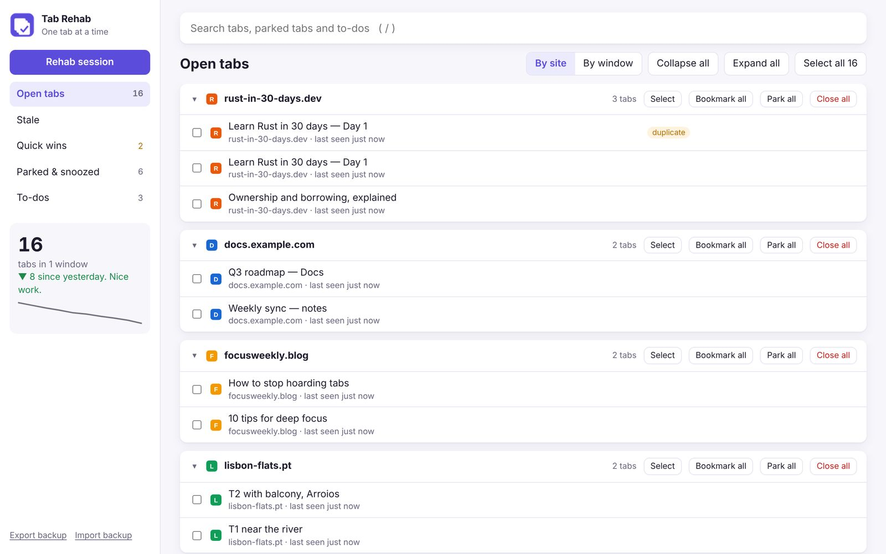

# Tab Rehab

**Hi. I have 347 tabs open.**

Tab Rehab is a free Chrome extension for chronic tab hoarders. It helps you close tabs without losing anything: one tab at a time, with an undo for everything. It also works in Edge, Brave and Arc.



**Website:** https://jorgesousa.github.io/tab-rehab/

## Why

People don't keep hundreds of tabs open because of clutter. They keep them because closing one feels like losing it, and because tabs act as a hidden to-do list. Tab Rehab answers those fears instead of just hiding tabs:

| The fear | What Tab Rehab does |
|---|---|
| "If I close it, I'll never find it again." | Every close has an Undo, a Recently closed list and backups. Parked tabs restore to the window they came from. |
| "I left it open so I wouldn't forget." | Turn the tab into a to-do with a note and a reminder. |
| "I might need it someday." | Snooze it so it reopens by itself, or bookmark it into a folder. |

## Features

- **Dashboard** of every tab in every window, grouped by site or by window, with search (`/`).
- **Rehab session:** your tabs one at a time, oldest first. Decide with one key: `K` keep, `T` to-do, `S` snooze, `B` bookmark, `P` park, `C` close.
- **Quick wins:** close duplicates, empty tabs, old searches and error pages in one click.
- **Stale tabs:** tabs you haven't opened in 1–30 days. Park them all at once (pinned and playing tabs are never touched). On top: the **Hall of Shame**, your 5 longest-ignored tabs, ranked and roasted.
- **Recovery:** are you getting better, was it safe to let go, did you do the things you kept tabs open for, and what's still hiding in your parked lists.
- **Relapse alerts:** one gentle nudge when you start climbing back above your best. Quiet hours, weekends off, pause any time.
- **Windows:** spot lonely and forgotten windows and merge them into one, with undo.
- **Park & restore:** save tabs to named lists and restore them later, back in their original windows.
- **Snooze:** close a tab now and have it reopen tonight, tomorrow, at the weekend or next Monday.
- **To-dos with reminders**, as Chrome notifications.
- **Bookmarks:** save a tab, a group or a parked list into a bookmarks folder.
- **Toolbar badge** with your live tab count: green within your tab budget, amber above it, red at twice the budget.
- **Safety net:** Undo, a Recently closed view, confirmation before parking more than 10 tabs, and JSON export/import.
- Right-click any page, or any tab in the tab strip, to park it, turn it into a to-do or snooze it. Open the dashboard with `Alt`+`Shift`+`T`.

## Install

Tab Rehab is in review on the Chrome Web Store. Until it's there, load it in developer mode:

1. Download [`tab-rehab.zip`](docs/tab-rehab.zip) (or clone this repo) and unzip it somewhere you'll keep.
2. Open `chrome://extensions` and switch on **Developer mode** (top right).
3. Click **Load unpacked** and choose the `tab-rehab` folder (or the `extension` folder if you cloned the repo).
4. Pin the icon, then click it or press `Alt`+`Shift`+`T`.

Using several Chrome profiles? Install it in each one: Chrome keeps profiles separate.

**Updating:** replace the files in the same folder, then click the reload arrow on Tab Rehab in `chrome://extensions`. Your parked tabs and to-dos stay.

## Privacy

Nothing leaves your laptop. No accounts, no servers, no analytics, no tracking. Everything lives in Chrome's local storage.

| Permission | Why |
|---|---|
| `tabs` | See, group, close and reopen your tabs. |
| `storage`, `unlimitedStorage` | Keep parked lists, to-dos and settings on this laptop. |
| `alarms` | Wake snoozed tabs and send reminders on time. |
| `notifications` | To-do reminders, the stale-tab nudge and relapse alerts. |
| `contextMenus` | The right-click menus on pages and on the tab strip. |
| `bookmarks` | Save tabs into the bookmarks folder you pick. |
| `favicon` | Show site icons in your lists. |

## Repository layout

```
extension/   the Chrome extension (Manifest V3, plain HTML/CSS/JS, no build step)
docs/        the website, served by GitHub Pages, plus tab-rehab.zip for download
ROADMAP.md   research, decisions and what's coming next
```

## Coming next

Page previews, one view across Chrome profiles, auto-backup, a weekly check-in and AI roasts written on your own laptop. See [ROADMAP.md](ROADMAP.md).

---

Built by [Jorge Sousa](https://github.com/jorgesousa).
